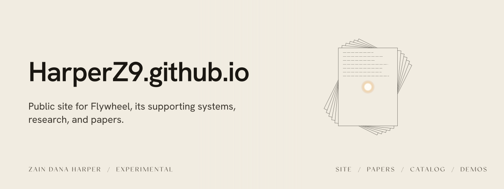

<picture>
  <source media="(prefers-color-scheme: dark)" srcset="https://raw.githubusercontent.com/HarperZ9/HarperZ9.github.io/main/docs/art/hero-dark.svg">
  
</picture>

# HarperZ9.github.io

Public site for Flywheel, its supporting systems, research, and papers.

```
git clone https://github.com/HarperZ9/HarperZ9.github.io.git
```

[](https://github.com/HarperZ9/HarperZ9.github.io/actions/workflows/ci.yml)
[](https://github.com/HarperZ9/HarperZ9.github.io/blob/main/LICENSE)


> Static public site for Zain Dana Harper: five consolidated open-source platforms
> (The Playground, BuildLang, The Flywheel, The Commons, and Research), live demos,
> open datasets, security hierarchy, essays, and career documents in all formats.

HarperZ9.github.io is the public workshop and front door for **Zain Dana Harper**.
Everything renders together in one field around five connected open-source platforms:
**The Playground** (`superframe` + `RAW` DX12 + *Low Water*), **BuildLang** (`buildc`
1.15.0 + `BDB` v2 SQL + RISC-V/OS), **The Flywheel** (`flywheel` 2.0.0 + `Articulate`
0.19.1 + `EMET` 1.3.1 + 31 consolidated packages), **The Commons** (`cmmns` 3.10.0),
and **Research** (30 reproducible findings including 12 nulls, 7 open datasets, and
13 DOI-indexed preprints). The site gives every reader a clear way in: meet the person
behind the work, inspect the unified architecture, run live interactive surfaces, review
sourced publications, or download current resumes, CV, and cover letters in HTML, PDF,
BuildTeX Designed PDF, DOCX, plain text, and Markdown.

## Deployment source

`HarperZ9/HarperZ9.github.io` is the canonical source and deployment repository
for the website and publications funnel. GitHub Pages deploys `main` from `/`.
`HarperZ9/HarperZ9` is a derivative GitHub profile index that links to verified
live routes. `HarperZ9/telos-v2` is reference-only; code may be ported from it
after verification, but it cannot overwrite or define the live site.

## Why it matters

The website has to serve both public readers and developers. Public readers
need plain language, working surfaces, and visible status; developers need
runnable demos, repo links, and a path from the page to the code behind it.
Rigor stays present as infrastructure -- source links, tests, dates, maturity
labels -- without becoming the headline of every page.

## Try it

```powershell
git clone https://github.com/HarperZ9/HarperZ9.github.io.git
cd HarperZ9.github.io
npx serve -l 8765 .
```

Use a server that gives `.mjs` files a JavaScript MIME type (`npx serve`
does). `python -m http.server` serves `.mjs` as `text/plain` on some Windows
setups, which silently breaks the Studio's module graph.

## What to test first

- Open `http://127.0.0.1:8765/`.
- Check the first viewport orients a new visitor: who this is, what the range
  is, where to enter.
- Verify public repo links, sample pages, and mobile/desktop readability.

## Current status

Static public portfolio and product-surface site. It should stay inspectable,
accessible, and honest about maturity; private systems stay bounded off-page.

## Pages

- `index.html` -- the world's entrance and front door, built by `scripts/build-world-home.mjs` around the six fixed landmarks, live interactive dial, and five consolidated platforms.
- `person.html` -- the person behind the work: background, arboriculture and creative craft, convictions, and the five platforms.
- `architecture.html` -- Five Platforms, One Field: interactive architecture graph, eight cohesive pipelines (`WF-01..WF-08`), 14 global-frontier lanes, eight project family trees, seven datasets (`DS-01..DS-07`), and live observed benchmarks with honest gaps.
- `hire.html` | `resume.html` | `cv.html` | `cover-letter.html` | `portfolio.html` | `dossier.html` -- career hub, five one-page role-tailored resumes, full CV, three cover letters, portfolio brief, and public dossier in `.html`, `.pdf`, BuildTeX `designed/*.pdf`, `.docx`, `.txt`, and `.md` formats.
- `security.html` | `security-toolkit.html` -- public security tools, advisories, and the capability-public 16-tool security and purple-team hierarchy.
- `papers/` -- the paper PDFs. `tools/build_latex_papers.py` typesets thirteen
  of them with Tectonic 0.17.0 against one pinned bundle, twice each with
  `SOURCE_DATE_EPOCH` fixed, and writes `papers/receipts/<name>.json` (source
  hash, engine, bundle digest, PDF hash). The six philosophy papers start from
  `writing/papers/*.md`, converted to `papers/tex/` by `tools/paper_latex.py`;
  seven start from LaTeX in a private research repository at a pinned commit.
  `python tools/build_latex_papers.py --check` confirms every receipt still
  matches its source and PDF. The Zenodo DOIs of the four deposited philosophy
  papers live in `papers/deposits.json`; `tools/build_zenodo_versions.py`
  builds the files for a new Zenodo version from a reserved version DOI
  without changing the committed PDFs. The two corpus PDFs are printed from their pages
  by `tools/print_documents.py`.
- `playground/` | `raw.html` | `low-water.html` | `buildlang.html` | `flywheel.html` | `cmmns.html` | `articulate.html` -- flagship platform pages and interactive browser studios.
- `research.html` | `publications.html` | `findings/` | `experiments/` -- research index, 30 reproducible findings (12 nulls), and 13 DOI-indexed preprints.

## Five consolidated platforms

| Platform | Public repo | Live scope |
| --- | --- | --- |
| **The Playground** (`THEPLAYGRND`) | `HarperZ9/superframe` + `HarperZ9/raw` | C++23 multi-backend rendering (CPU/D3D12/Vulkan/WebGPU), RAW DX12 live pipeline (`96/96`), spectral material & `64v/126t` flora meshlet forge, SI rigid-body `physai` (`30,670` steps/s), `NOH-1` (`1,149.9x`), CLAP/VST3 audio, `512^3` cosmology, and *Low Water*. |
| **BuildLang** (`BLDLNG`) | `HarperZ9/buildlang` | Rust-built capability-effect systems language (`buildc 1.15.0` on crates.io), C/HLSL/GLSL/experimental Wasm & x86-64 backends, `BDB` v2 SQL (`2.89 MB` paging, `0/500` silent fuzz corruptions), `procgen_forge.bld` (`2,132.3x`), `aerospace_ai_kernels.bld` (`1,008.5x`), `workstation_mcp.bld` (`69.92 us`), RV64 toolchain, and `BuildTeX`. |
| **The Flywheel** (`THEFLYWHEEL`) | `HarperZ9/flywheel` | Model-agnostic AI workstation & verification harness (`v2.0.0` on PyPI, 31 consolidated packages) including `Articulate` (`0.19.1`), `EMET` (`1.3.1`), `Accountable Surface`, `FlagshipAgentSDK`, Three-Plate Verification Oracle (`115/115` recall), `gather/deconstruct`, and JFC-3P Arm C (`95.83%`, `p=4e-6`). |
| **The Commons** (`THECMMNS`) | `HarperZ9/cmmns` | Local-first AGPL-3.0 browser extension (`v3.10.0`) surfacing source provenance, coordination cues, fact-checks, and Web Crypto capture receipts across nine social platforms. |
| **Research & Showcase** (`RSRCH`) | `HarperZ9/HarperZ9.github.io` | 30 reproducible empirical findings (12 nulls), 7 open verifiable datasets (`DS-01..DS-07`), 13 DOI-indexed preprints, interactive explainers, and 41 merged external OSS PRs across 34 repositories. |

Private platform and product work exists behind these leaves; public claims stay
limited to outcomes and categories, never internals.

## Local verification

Serve this directory locally (see **Try it** above for the MIME caveat), then
visit `http://127.0.0.1:8765/`. Before publishing, verify:

- The first viewport orients: range, entry points, working surfaces.
- Internal links and `*-sample.html` resolve; no link 404s.
- External GitHub links point at intended public repositories.
- The page stays legible at desktop and mobile widths.
- No secrets, generated logs, or private artifacts are staged.

Test suites:

```powershell
python -m pytest tests -q
node --test "system/**/*.test.mjs"
node tests/linkcheck.mjs
```

## Licence

Written works: CC BY 4.0. The site's code, design and art: all rights reserved.

- **Papers, essays, briefings and research pages** are licensed CC BY 4.0.
  Share and adapt them with credit to Zain Dana Harper. Papers with a Zenodo
  deposit carry the same licence there. [`LICENSE-TEXT`](LICENSE-TEXT) lists
  the covered files.
- **The site's own code, design, art, brand and portfolio pages** are all
  rights reserved. You can read the code, review it and learn from it. Reusing
  it needs written permission. [`LICENSE`](LICENSE) gives the terms.
- **Third-party and vendored material** keeps its own licence: D3 (ISC),
  panzoom and Tweakpane (MIT), React in the home page bundle (MIT), Hanken
  Grotesk (SIL OFL 1.1), and the Conso font under its designer's terms. The
  table in [`LICENSE`](LICENSE) names each path, and a licence file or note
  sits beside each one.

The reusable engines behind the site are source-available under FSL-1.1-MIT
in their own repositories.
[raw-native](https://github.com/HarperZ9/raw-native) already ships under it.
The copies vendored here carry it too:
[superstack](https://github.com/HarperZ9/superstack) v0.2.0,
[reconcile](https://github.com/HarperZ9/reconcile) v0.2.0, and sense-core and
render-nd from studio-libs v0.2.0. [Learn](https://github.com/HarperZ9/flywheel/tree/main/packages/learn) has
its own licence. Use those repositories if you want to build on an engine.

## For developers

Keep the public README, examples, and repository metadata aligned with current
behavior. Before opening a PR or publishing a release, verify the working tree
and any documented commands for this repo.

```bash
git status --short
```

---

Built by **[Zain Dana Harper](https://harperz9.github.io)** in Seattle: evidence-first tools that leave a re-checkable artifact behind. The full workbench is at [harperz9.github.io](https://harperz9.github.io).
